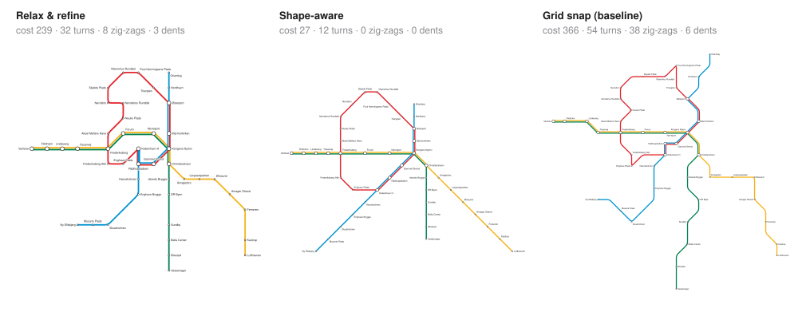
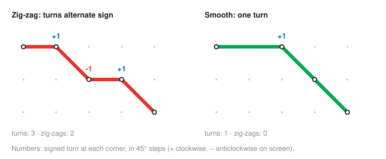
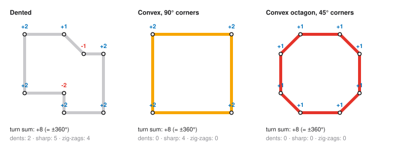
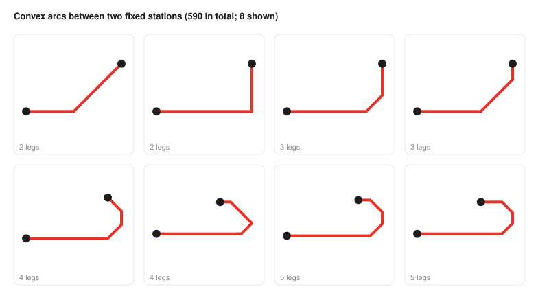
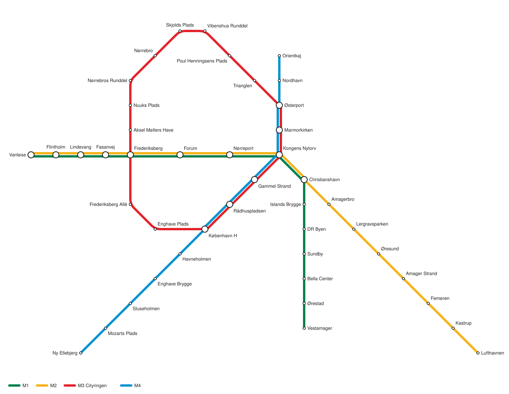

# Aesthetics and the shape-aware algorithm

[How the layout algorithm works](algorithm.md) describes the default algorithm, relax & refine.
That algorithm makes every line octilinear, but it judges a layout one station at a time. It
can't see the *shape* of a whole line, so it leaves zig-zags, dents in ring lines and
staircases.

This document does three things:

1. **Formalises** what a good metro-map shape is, as a weighted cost function that can score
   any layout (`evaluate` in `src/aesthetics.ts`).
2. **Describes the shape-aware algorithm** (`shapeAware` in `src/algorithms/shape-aware.ts`),
   which minimises that cost.
3. **Measures the result** against the other algorithms.

All illustrations and numbers are generated from the real code by `npm run docs:figures`.



## Contents

1. [Lines as turn sequences](#lines-as-turn-sequences)
2. [Zig-zags](#zig-zags)
3. [Simple, consistent shapes](#simple-consistent-shapes)
4. [Other aesthetic goals](#other-aesthetic-goals)
5. [The cost function](#the-cost-function)
6. [The shape-aware algorithm](#the-shape-aware-algorithm)
7. [Results](#results)
8. [Limitations](#limitations)

## Lines as turn sequences

Every goal below is measured on the line **as it will be drawn**: the grid path of each of
its edges joined in travel order, bends included. This polyline is split into maximal
straight **legs**. Each leg has:

- a **direction** `d` ∈ {0, …, 7}, in 45° steps: 0 = east, 2 = south, 4 = west, 6 = north.
  These run clockwise on screen, because screen y points down.
- a **length** in grid steps (a diagonal step counts as 1).

Between two consecutive legs, the line makes a **turn**:

```
τ = (d₂ − d₁) mod 8, mapped to −3 … +4
```

So τ = +1 is a 45° turn clockwise, −2 is 90° anticlockwise, and 4 is a U-turn. A line is
fully described, up to scale, by its sequence of turns and the leg lengths between them. All
the shape goals are simple rules about this sequence.

Every turn costs something, and sharper turns cost much more:

| Turn | 45° | 90° | 135° | 180° |
| --- | ---: | ---: | ---: | ---: |
| Cost | 1 | 3 | 8 | 20 |

## Zig-zags

A **zig-zag** is two consecutive turns in opposite directions: τᵢ and τᵢ₊₁ are both non-zero
and have opposite signs. The line jogs one way and then straight back. U-turns are excluded,
because they are already penalised heavily as turns.



- **Cost:** 5 per zig-zag. If the straight leg between the two turns is longer than 2 grid
  steps, the cost halves to 2.5. A short jog looks nervous; a long offset reads as a
  deliberate shift.
- **For a ring line**, the sequence wraps around, so the last and first turns form a pair too.

## Simple, consistent shapes

### Ring lines

A ring line such as Copenhagen's M3 Cityringen is a closed polygon. Two facts about closed
curves make "simple, consistent shape" precise:

1. **The turns of a simple closed curve add up to ±360°** (Hopf's turning-tangent theorem).
   In 45° units: Σ τᵢ = ±8. The sign σ says which way the ring runs.
2. **A ring is convex exactly when every turn has the same sign as σ.** A turn against σ is a
   dent.

Among convex octilinear rings, the one that uses the simplest turn everywhere is the
**octagon**: eight turns of exactly +1 (or −1). Its corners are all 45°, the same at every
corner. That gives three rules:

| Rule | Cost |
| --- | --- |
| A turn against the ring's direction (a dent) | 6 per turn |
| A turn in the ring's direction sharper than 45° | 2 per extra 45° |
| Every turn | as in the turn table above |



The three rings above all turn +8 in total. The dented ring pays for its dents, its sharp
corners and the zig-zags those dents create. The square pays for four 90° corners
(4 × 3 + 4 × 2 = 20). The octagon pays only for eight 45° turns (8 × 1 = 8), so it wins.

### Open lines

An open line should keep heading roughly the same way. Its **overall direction** is the
vector D from its first station to its last. Every leg that points more than 90° away from D
(leg · D < 0) is a **backtrack** and costs 3. A line that goes out and comes back looks like
an error on a map.

### Arcs for chains

The same idea also applies to parts of a line. A **convex octilinear arc** is a path of up to
five legs whose directions are consecutive and turn the same way: d, d + σ, d + 2σ, …. Every
turn is 45° and goes the same way, for at most 180° in total. Straight lines, one-bend paths,
L-shapes, quarter octagons and half octagons are all arcs.



The shape-aware algorithm uses arcs as building blocks (see [chain moves](#moves)). With the
two end stations fixed and the leg directions chosen, the leg lengths ℓᵢ must satisfy:

```
Σ ℓᵢ · uᵢ = b − a          (uᵢ = unit grid vector of direction i)
```

That's two equations. Legs 1 and 3 point 90° apart, so they can be solved for exactly once
the other legs are chosen. The remaining legs are enumerated. Only whole-number, non-negative
solutions are valid. Between two stations 6 across and 3 up, that gives 590 different arcs.

## Other aesthetic goals

Beyond zig-zags and shapes, these goals come from common metro-map design practice, and from
problems seen in this project's own output:

| Goal | Why | How it's measured | Cost |
| --- | --- | --- | --- |
| **Station on an edge** | A line seems to call at a station it doesn't serve | a station's grid cell lies on another edge's path | 40 each |
| **Crossing** | Crossings are hard to follow | two edges without a common station cross | 15 each |
| **Clean junctions** | Two lines leaving a station in the same direction overlap and can't be told apart | two edges leave a station in the same direction | 25 each |
| **Straight edges** | A bend between two stations is a kink nobody asked for | an edge that isn't straight on the grid | 2 each |
| **Even rhythm** | Even spacing along a line reads calmly | difference in length between consecutive edges of a line | 0.5 per grid step |
| **Label room** | Labels on a horizontal edge sit above or below; if they don't fit side by side, readers attach them to the wrong station | a horizontal edge shorter than ½ × (both names' lengths) × 0.105 + 0.3 grid steps | 3 per missing step |
| **Geographic orientation** | The map should still resemble the city | angle θ between an edge on the grid and in reality | 2 × (θ − 45°) / 45° beyond 45° |
| **Compactness** | Keeps the map from sprawling | edge length beyond 1 grid step | 0.3 per step |
| **Maximum length** | Very long edges waste space | edge length beyond `maxEdgeLength` (3) | 3 per step |

The **label room** goal was invented after the first version of the algorithm packed seven
ring stations one grid step apart on a straight top edge. That ring was perfectly convex, but
its labels were unreadable. 0.105 grid steps per character corresponds to a 12 px font
(about 6.7 px per character) on the default 64 px grid.

## The cost function

`evaluate(prepared, grid, options)` scores a grid layout against every goal. It returns:

- `total`: the weighted sum. Lower is better.
- `cost`: what each goal contributes.
- `count`: how often each problem occurs, e.g. the number of zig-zags.

Every weight can be overridden:

```ts
import { evaluate, prepareNetwork, project, shapeAware } from "metromap";

// Score any grid layout.
const prepared = prepareNetwork(network);
const score = evaluate(prepared, grid, { geo: project(prepared.stations) });
score.count.zigzag; // 0

// Lay out with different priorities: geography matters more, label room less.
shapeAware.layout(network, { weights: { geo: 6, labelRoom: 1 } });
```

The defaults are in `DEFAULT_WEIGHTS`. Their order reflects a judgement about what hurts a map
most: things that make it *wrong* (a station on an edge, overlapping lines) cost far more than
things that make it *ugly* (zig-zags, dents), and those cost more than things that make it
*imperfect* (uneven rhythm, compactness).

## The shape-aware algorithm

The algorithm starts from the relax & refine layout and then minimises the cost function.
Relax & refine's local search can only move one station at a time. That's why it can't fix a
staircase: every single step makes things worse before the whole line gets better. So
shape-aware works with moves at three scales.

### Moves

**Single station.** Move one station to one of its 8 neighbouring cells, the same as relax &
refine.

**Chains.** A *chain* is a run of stations between junctions (stations with exactly two
edges in the middle, anything else at the ends). For example, the north-west part of the
Copenhagen ring, from Frederiksberg to Østerport, is one chain of 8 stations. A chain can be:

- **shifted** by one cell in any of the 8 directions, all its inner stations at once
- **re-laid on an arc** between its two end stations, with its stations spread evenly along
  it. There are hundreds of arcs, so they're ranked by how little they move the stations, and
  the closest 8 are fully scored.
- **straightened**, if it's a branch ending at a terminus: laid out in a straight line from
  its junction, in any of the 8 directions

**Ring refit.** Place a ring line's stations, in route order and evenly spaced, on an
octilinear octagon fitted around its current bounding box. The box may also be grown by 1–3
cells, and every corner cut from 0 (a rectangle) to half the box is tried. The stations are
rotated around the octagon to stay closest to where they are, and the ring keeps its
direction.

### Compound moves with repair

Some improvements need several moves at once. In Copenhagen, the ring line M3 shares six
stations with M4. Refitting the ring alone bends M4 out of shape, so on its own the refit is
always rejected. A **compound move** makes a big change first: refit a ring, or move a
junction by one cell. Then it **repairs** every chain attached to what moved, greedily, using
the chain moves. The result is judged as a whole.

### Search

```
start from the relax & refine layout
descend:
  repeat:
    cheap passes until nothing improves: ring refits, chain moves, single moves
    one pass of compound moves; stop if none helped
iterated local search, 4 times:
  from the best layout so far, apply one random compound perturbation
  (accepted even if it is worse), then descend again; keep the result if it is better
```

Within each pass, every candidate is fully scored, and the best improving one is taken. A
seeded random number generator (`seed`, default 1) makes the restarts reproducible: the same
input and seed always give the same map.

**What didn't work: simulated annealing.** Annealing (random moves, sometimes accepting a
worse layout as a temperature cools) was tried first. Over 4000 steps it never beat the
greedy result on Copenhagen. Its random moves are mostly single stations, and this landscape
only gives way to coordinated moves. Iterated local search with compound perturbations,
measured on the same input with 6 restarts, improved the cost from 45.6 to 27–39 depending
on the seed.

## Results



On the Copenhagen Metro (counts of each problem; lower is better):

| Goal | Relax & refine | Shape-aware | Grid snap (baseline) |
| --- | ---: | ---: | ---: |
| `stationOnEdge` | 1 | 0 | 0 |
| `crossing` | 0 | 0 | 0 |
| `overlap` | 1 | 0 | 0 |
| `edgeBend` | 0 | 0 | 16 |
| `tooLong` | 0 | 0 | 0 |
| `length` (grid steps) | 52 | 50 | 76 |
| `turn` | 32 | 12 | 54 |
| `zigzag` | 8 | 0 | 38 |
| `loopConcave` | 3 | 0 | 6 |
| `loopSharp` | 3 | 0 | 5 |
| `backtrack` | 1 | 0 | 1 |
| `rhythm` (grid steps) | 20 | 7 | 23 |
| `geo` (edges > 90° off) | 1 | 0 | 0 |
| `labelRoom` | 11 | 5 | 2 |
| **Total cost** | **238.6** | **27.0** | **365.7** |
| Time (Node, Apple Silicon) | ~90 ms | ~2 s | ~1 ms |

- **The ring is a convex octilinear polygon:** no dents, no corner sharper than 45°, and the
  stations still in route order.
- **No line zig-zags**, and the lines make 12 turns in total instead of 32.
- **Trunks are straight:** M1/M2 run as one horizontal line through the centre, and every
  branch to a terminus is a single straight stroke.
- **Label room isn't fully solved:** 5 horizontal edges are still too short for their names.
  Fixing them would cost more elsewhere at the current weights.

The made-up Riverside network goes from a cost of 11.7 to 1.4: three straight strokes and a
single turn.

## Limitations

- **It's slow compared with relax & refine:** about 2 s for 44 stations in Node and a little
  more in a browser, against about 90 ms. Each evaluation re-scores the whole layout (about
  0.06 ms), and a run makes tens of thousands of them. Incremental scoring, which re-scores
  only what a move changed, would be the main speed-up.
- **The result depends on the seed.** With 4 restarts, Copenhagen scores between 27 and 46
  across seeds 1–6. It's still a local search; more restarts (`restarts`) trade time for
  quality.
- **Geography gives way to shape.** With the default weights, M4 becomes one long diagonal,
  and Vanløse–Nørreport runs due east. That's typical of schematic maps, but raise the `geo`
  weight if fidelity matters more.
- **The weights were tuned by hand** on the two sample networks. Other networks may want
  other priorities, which is why all weights can be overridden.
- **Label room is a proxy.** It only checks horizontal edges, using estimated text widths. It
  doesn't model the actual label placement done by the renderer.
- **Lane order isn't optimised.** Lines on shared track keep their input order, so crossings
  where lines split are possible (see [algorithm.md](algorithm.md#limitations)).
