# How the layout algorithm works

This document explains how the default algorithm, **relax & refine** (`relaxRefine`, also used
by `layout()`), turns stations and lines into a metro map.
It follows the code step by step, with the source location and the exact constants
for each step.

All illustrations are generated from the real code by `scripts/figures.mjs`. Most of
them show the Copenhagen Metro sample. To regenerate them after changing the
algorithm, run:

```shell
npm run docs:figures
```

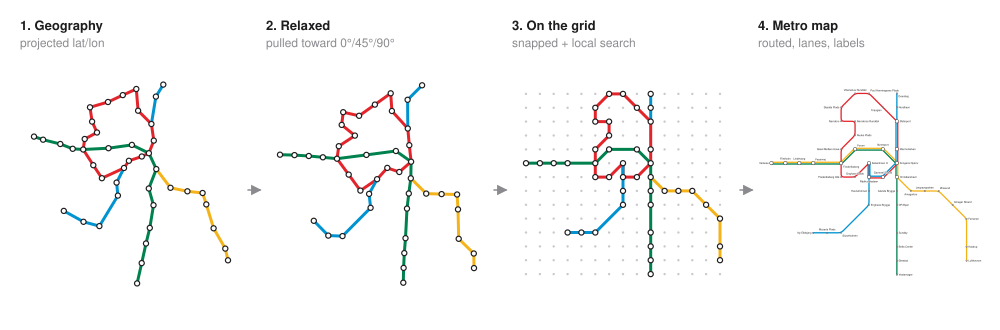

## Contents

1. [The problem](#the-problem)
2. [Overview](#overview)
3. [Step 1: Prepare the input](#step-1-prepare-the-input)
4. [Step 2: Project](#step-2-project)
5. [Step 3: Relax toward octilinear](#step-3-relax-toward-octilinear)
6. [Step 4: Snap to the grid](#step-4-snap-to-the-grid)
7. [Step 5: Local search](#step-5-local-search)
8. [Step 6: Route edges](#step-6-route-edges)
9. [Step 7: Lanes for shared track](#step-7-lanes-for-shared-track)
10. [Step 8: Drawing (stations and labels)](#step-8-drawing-stations-and-labels)
11. [Adding an algorithm](#adding-an-algorithm)
12. [Constants](#constants)
13. [Performance](#performance)
14. [Limitations](#limitations)
15. [Related work](#related-work)

## The problem

A geographic map of a metro network is hard to read. Downtown stations crowd together,
suburban ones spread far apart, and lines wander in every direction. A *schematic* metro
map (the style made famous by Harry Beck's 1933 London Underground map) trades
geographic accuracy for legibility. It follows a few rules:

- **Octilinear lines.** Every line segment is horizontal, vertical or at 45°.
- **Even spacing.** Stations are spread out more evenly than in reality.
- **Few bends.** Lines run as straight as possible.
- **Recognisable shape.** The map still resembles the real geography, so north stays
  up and east stays right.
- **No clutter.** Lines don't cross needlessly or run through stations they don't
  serve, and labels don't collide.

These goals pull against each other, and computing the best possible layout is NP-hard.
This project uses a fast heuristic that produces a good layout, not a provably
optimal one.

## Overview

The algorithm runs eight steps. Only steps 3 and 5 are specific to relax & refine. The
others are shared by every grid-based algorithm (see
[Adding an algorithm](#adding-an-algorithm)). `computeStages()` runs steps 1–6 and returns
every intermediate result, which is what the figures here are drawn from.

| Step | Function | Where | What it produces |
| --- | --- | --- | --- |
| 1. Prepare the input | `prepareNetwork` | shared: `src/pipeline.ts`, `src/network.ts` | validated lines, a lat/lon for every station, one edge per station pair |
| 2. Project | `project` | shared: `src/pipeline.ts` | positions in units of one typical station gap |
| 3. Relax | `relax` | `src/algorithms/relax-refine.ts` | positions where edges point roughly in the 8 directions |
| 4. Snap | `snapToFreeCells` | shared: `src/pipeline.ts` | one whole-number grid cell per station |
| 5. Local search | `refine` | `src/algorithms/relax-refine.ts` | grid positions with fewer bends, crossings and collisions |
| 6. Route | `routeEdge` | shared: `src/pipeline.ts` | each edge as a straight line, or with one 45° bend |
| 7. Lanes | `buildMetroMap`, `offsetPolyline` | shared: `src/pipeline.ts` | per-line paths, offset side by side, in canvas pixels |
| 8. Draw | `renderSvg` | `src/render.ts` | an SVG with one dot per station, and labels |

The core idea has two parts. Steps 2–3 are **continuous**: stations move freely, so the
network can untangle smoothly from its geographic shape. Steps 4–5 are **discrete**: on
a grid, "is this edge exactly 45°?" becomes a simple yes/no question, and small moves
can be scored exactly.

## Step 1: Prepare the input

### Validation and defaults

`prepareNetwork` calls `normalizeLines` (`src/network.ts`), which does three things:

- rejects duplicate station names, routes that refer to unknown stations, and the same
  station twice in a row
- gives every line without a colour one from the palette
- keeps the route exactly as written, including the repeated first station that closes
  a loop

### Missing coordinates

Stations may omit lat/lon. `fillMissingCoordinates` estimates their position from the
lines they're on:

- **Between two known stations:** interpolate evenly. Two unknown stations between A
  and D land at t = 1/3 and t = 2/3.
- **Past the last known station:** extend in the direction of the route's last two
  known stations, by the line's average spacing per station.
- **On several lines:** average the estimate from each line.

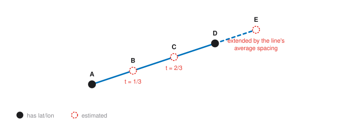

A station that no line can place keeps no coordinates. The relaxation then starts it on
a small circle around the centre of the network and lets the forces place it.

### Edges

`buildEdges` merges all routes into an undirected set of **edges**, one per pair of
stations that are next to each other on any line. Each edge remembers:

- **which lines use it, in input order.** This becomes the lane order in step 7.
- **a reference direction:** the direction the first of those lines travels it. This
  defines which side counts as "left" when lanes are offset.

The layout positions stations and edges. Lines only come back in at step 7.

## Step 2: Project

`project` converts lat/lon to flat x/y with an equirectangular projection:

```
x = lon × cos(mean latitude)
y = −lat                      (screen y points down, so north is up)
```

Multiplying by the cosine of the latitude corrects for meridians converging toward the
poles. Without it, Copenhagen (55.7° N) would be stretched to almost twice its width.

Then everything is **scaled so the median nearest-neighbour distance is 1**. From now on,
1 unit means "a typical gap between stations", and it is also the grid step used in
step 4. Measuring the nearest neighbour makes the scale independent of whether the
input is a city or a country.

## Step 3: Relax toward octilinear

`relax` is a force-directed simulation that runs a fixed **600 iterations**. In each
iteration every station collects corrections from four rules, averages them, and moves
**half** of that average. Moving halfway damps oscillation.

### The octilinear target

For each edge `d = v − u`, `octilinearTarget` finds the ideal vector it should become:

1. Pick the nearest of the 8 directions (0°, 45°, …, 315°). Each direction owns a 45°
   sector, from 22.5° below it to 22.5° above it.
2. Project `d` onto that direction and round to a whole number of grid steps between
   1 and `maxEdgeLength` (3 by default).

Diagonal directions are `(±1, ±1)`, not unit vectors. That way a diagonal edge of
"2 steps" ends exactly on a grid point, `(2, 2)`, which makes step 4 lossless.

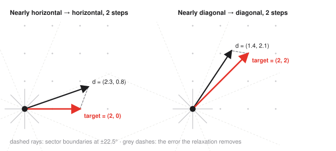

Whole-number lengths of 1–3 do two jobs. Short downtown edges are stretched to at least
1, which equalises spacing. Long suburban edges keep some of their length, up to 3,
which preserves a sense of distance.

### The four forces

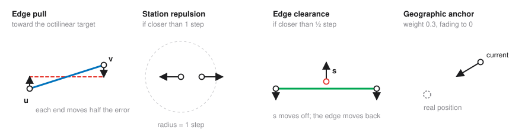

| Force | Applies when | Effect |
| --- | --- | --- |
| **Edge pull** | always, every edge | moves `u` and `v` each by half the error `d − target` |
| **Station repulsion** | two stations closer than 1 unit | pushes both apart until they are 1 unit apart |
| **Edge clearance** | a station closer than 0.5 units to an edge it isn't on | pushes the station away and the edge's ends the other way |
| **Geographic anchor** | stations with known coordinates | pulls toward the projected position with weight `0.3 × (1 − iteration/600)` |

The anchor weight fades linearly to zero. Early on, geography dominates, so the network
keeps its overall shape. By the end, only the schematic rules remain, so edges can settle
into clean directions.

### How far the relaxation gets

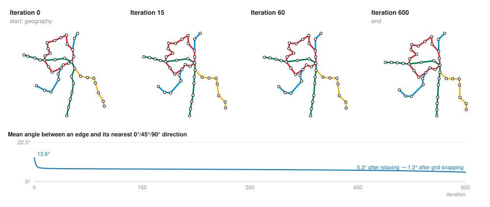

The chart shows something important. Most of the improvement happens in the first few
dozen iterations. The relaxation alone does **not** make edges exactly octilinear: many
are still a few degrees off at the end. Its job is to find a good *arrangement*, with
stations in the right order and in roughly the right directions. Exactness comes from
the grid in the next step.

## Step 4: Snap to the grid

`snapToFreeCells` rounds every position to the nearest whole-number cell. Two stations
may round to the same cell, so they are processed **busiest first** (by number of edges):

- a station takes its rounded cell if it's free
- otherwise it searches outward ring by ring and takes the nearest free cell

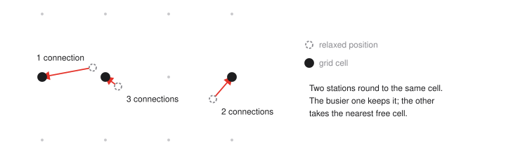

Busy stations are interchanges, which matter most to the map's structure, so they keep
their preferred spot.

## Step 5: Local search

Snapping can break things. An edge that was 44° may now be "2 across, 1 up", which is
not octilinear. A path may run through another station. `refine` repairs these with
**greedy hill climbing**:

```
repeat up to 8 times:
  for each station s:
    try s in each of its 8 neighbouring free cells
    keep the cell with the lowest local cost (stay if nothing is cheaper)
  stop early if no station moved
```

The **local cost** of a station adds up the cost of its edges and of the turns at it
and its neighbours:

| Situation | Cost |
| --- | --- |
| Edge is not octilinear, so it will need a bend | 6 |
| Edge longer than `maxEdgeLength` | 3 per extra step |
| Edge's path runs through another station (within 0.3 units) | 40 |
| Edge crosses an edge it doesn't share a station with | 15 |
| A line turns 45° at a station | 1 |
| A line turns 90° | 3 |
| A line makes a near U-turn (more than 120°) | 12 |

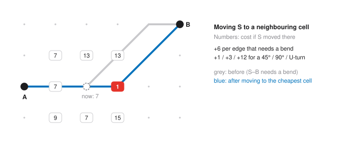

In the example, S sits so that S–B needs a bend (cost 6, plus 1 for the turn at S).
Moving S one cell right makes both edges octilinear, leaving just a 45° turn (cost 1).

Paths are scored **exactly as they will be drawn**: `refine` calls the same `routeEdge`
function as step 6. This matters. An earlier version scored edges as straight lines and
happily placed a bend right on top of another station.

## Step 6: Route edges

On the grid, every edge falls into one of two cases:

- **Octilinear** (horizontal, vertical or exactly diagonal): drawn as a straight line.
- **Anything else**, like "3 across, 2 up": drawn with exactly **one 45° bend**. There
  are two ways to do that: diagonal first, then straight, or straight first, then
  diagonal. `routeEdge` picks the one whose bend point is farther from other stations.

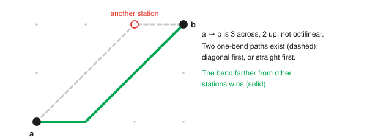

## Step 7: Lanes for shared track

When several lines share an edge, they are drawn side by side. On an edge with `n`
lines, line number `i` (in input order) is offset sideways by:

```
offset = (i − (n − 1) / 2) × laneWidth          (laneWidth = 8 px by default)
```

The offset is measured to the left of the edge's **reference direction**. That keeps the
lane order the same along a corridor, even when lines travel it in opposite directions.
At bends, `offsetPolyline` uses **miter joins**, so parallel lanes stay exactly one lane
apart through the corner.

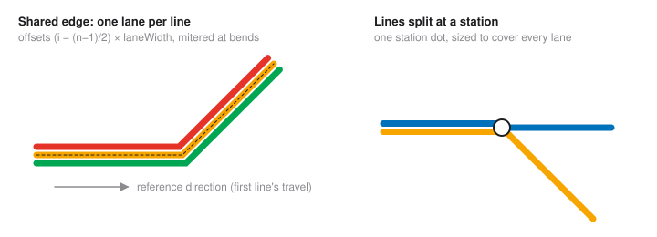

A line's lane can change at a station, for example where two lines split. Its incoming
segment then ends at a slightly different point than its outgoing segment starts. The
small jog between them is hidden under the station's dot, which is sized to cover every
lane (see step 8).

Finally, grid coordinates are converted to canvas pixels:
`x = (gridX − minX) × spacing + padding`, and the same for y.

## Step 8: Drawing (stations and labels)

`renderSvg` (`src/render.ts`) draws the `MetroMap` that any algorithm returns. It is
separate from the layout, so you can draw the output any other way.

### Lines

Each line is one continuous path through all its segments. Corners are rounded with a
quadratic curve, radius 14 px by default.

### Stations

Every line calls at every station on its route, so each station gets **exactly one dot**,
at its centre:

- **One line:** a small white dot on the line, radius `stationRadius` (3.2 px).
- **Two or more lines (interchange):** a larger white dot with a heavier outline. Its
  radius is the distance from the centre to the farthest lane end, plus half a line width,
  plus 1 px, and at least 1.6 × `stationRadius`. That way it covers every lane passing
  through, including the jogs where lines change lane.

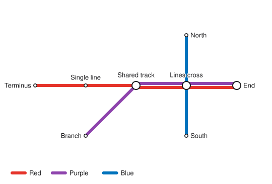

### Labels

Labels are placed **greedily**, busiest stations first. Each label tries 8 spots around
its station and takes the one with the lowest penalty:

| Term | Penalty |
| --- | --- |
| Base preference | right 0, left 0.5, upper/lower right 1, above/below/left diagonals 1.5 |
| Crosses a line segment | 8 per segment |
| Overlaps an already placed label | 30 + 0.5 × overlap area |
| Covers a station dot | 20 |
| Closer to another station than to its own | 40 |
| Outside the canvas | 10 |

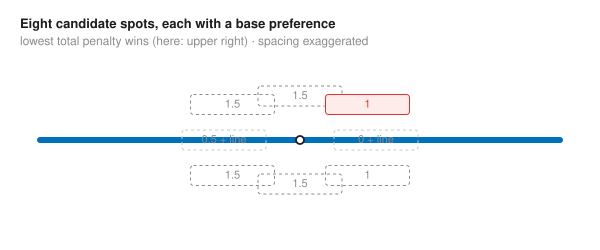

The "closer to another station" term prevents the most confusing mistake on a dense
map: a label sitting between two stations, where readers attach it to the wrong one.

### The result

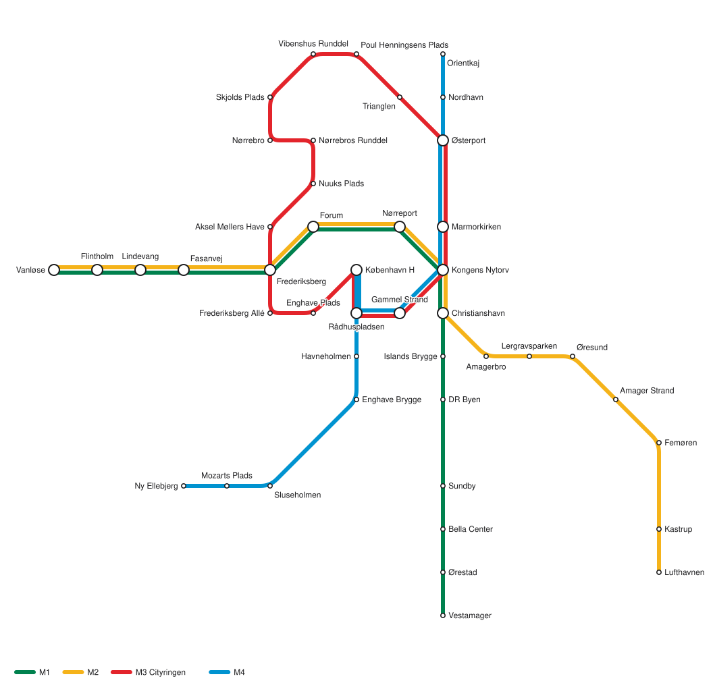

## Adding an algorithm

Every algorithm implements `LayoutAlgorithm` (`src/algorithm.ts`):

```ts
interface LayoutAlgorithm<O extends CanvasOptions = CanvasOptions> {
  id: string;          // stable identifier, e.g. "relax-refine"
  name: string;        // shown in the demo's picker
  description: string; // one sentence
  layout(network: Network, options?: O): MetroMap;
}
```

Most algorithms only differ in **where they put the stations**. `defineGridAlgorithm` builds
a complete algorithm from just that placement step. It reuses the shared pipeline:
validation (step 1), edge routing (step 6), lanes and canvas scaling (step 7).

```ts
import { defineGridAlgorithm, project, snapToFreeCells } from "metromap";

export const gridSnap = defineGridAlgorithm({
  id: "grid-snap",
  name: "Grid snap (baseline)",
  description: "Rounds the geography to the nearest grid cells, with no further optimisation.",
  // One whole-number grid point per station, in prepared.stations order.
  place: (prepared) => snapToFreeCells(project(prepared.stations).map((p) => p ?? { x: 0, y: 0 }), prepared.adjacency),
});
```

The `place` function receives a `PreparedNetwork`:

- **`stations`**: lat/lon, with missing coordinates already estimated
- **`edges`**: station indices `a` and `b`, plus the lines using each edge
- **`adjacency`**: the edges touching each station
- **`lines`**: the validated lines

It must return grid positions that are whole numbers, one free cell per station, so edges
can be routed octilinearly. An algorithm that routes edges itself can pass its own paths to
`buildMetroMap`. One that doesn't fit the grid model at all can implement `layout`
directly, as long as it returns a valid `MetroMap`.

To make a new algorithm available everywhere:

1. Add it to `ALGORITHMS` in `src/algorithms/index.ts`. It then appears in the demo's
   *Algorithm* picker.
2. The property tests in `test/layout.test.ts` run automatically for every registered
   algorithm. They check that every station is kept, positions are unique, every leg is
   0°/45°/90°, there is one segment per route pair, and everything stays inside the canvas.

Three algorithms ship today:

| Algorithm | Idea | Copenhagen |
| --- | --- | --- |
| `relaxRefine` (default) | everything in this document | ~70–100 ms |
| `shapeAware` | relax & refine, then optimises whole-line shapes: no zig-zags, convex 45° rings, even rhythm ([aesthetics.md](aesthetics.md)) | ~2 s |
| `gridSnap` | project and round to the grid; steps 3 and 5 skipped | ~1 ms |

The baseline is useful for comparison: it shows what the relaxation and local search add.

## Constants

The constants were tuned by eye on the two sample networks.

| Where | Constant | Value |
| --- | --- | --- |
| `CanvasOptions` (all algorithms) | `spacing`: pixels per grid step | 64 |
| | `laneWidth`: pixels between parallel lines | 8 |
| | `padding`: canvas margin | 80 |
| `RelaxRefineOptions` | `maxEdgeLength`: longest edge, in grid steps | 3 |
| `relax` | iterations | 600 |
| | step size: share of the averaged correction applied | 0.5 |
| | minimum station distance | 1 unit |
| | minimum station–edge distance | 0.5 units |
| | initial anchor weight, fading linearly to 0 | 0.3 |
| `refine` | maximum passes | 8 |
| | costs | see [Step 5](#step-5-local-search) |
| `RenderOptions` | `lineWidth` / `stationRadius` / `cornerRadius` / `fontSize` | 6 / 3.2 / 14 / 12 |

## Performance

For `n` stations and `m` edges:

- **Relaxation:** each iteration checks all station pairs and all station–edge pairs, so
  it costs O(n² + n·m) per iteration, times 600.
- **Local search:** each candidate move rescores the moved station's edges against all
  stations and edges, so a pass costs O(n · 8 · deg · (n + m)).

That's fine at city scale. The 44-station Copenhagen Metro lays out in about 100 ms in a
browser, and the 14-station Riverside sample in under 10 ms. For networks with thousands
of stations, the all-pairs checks would need a spatial index, such as a grid hash.

## Limitations

- **Local search moves one station at a time.** It can't fix problems that need several
  stations to move together, such as the staircase on the M3 ring near Nørrebro. The
  shape-aware algorithm fixes this with chain, ring and compound moves
  ([aesthetics.md](aesthetics.md)).
- **Lanes are ordered by input order.** This can make lines cross at a station where they
  split, if the line that turns off sits on the far lane. Choosing the lane order to
  minimise crossings is a known, harder problem ("metro-line crossing minimisation").
- **Labels are placed greedily and their width is estimated** (characters × 0.56 ×
  font size). A crowded area can still end up with a label across a line.
- **The constants are hand-tuned.** Different networks may prefer different weights. For
  example, a larger `maxEdgeLength` keeps more of the geography.
- **There is no optimality guarantee.** See Related work for exact methods.

## Related work

This algorithm borrows ideas from published approaches without implementing any one of
them exactly:

- **Force-directed / spring layouts for metro maps.** Hong, Merrick, do Nascimento,
  *Automatic visualisation of metro maps* (2006). The idea of pulling edges toward
  preferred directions with spring-like forces, as in step 3.
- **Multicriteria hill climbing on a grid.** Stott, Rodgers, Martínez-Ovando, Walker,
  *Automatic metro map layout using multicriteria optimization* (2011). Stations on grid
  points, improved by moving them to nearby cells under a weighted cost, as in step 5.
  Their method also moves whole clusters of stations and places labels in the same
  optimisation.
- **Exact layout with mixed-integer programming.** Nöllenburg, Wolff, *Drawing and
  labeling high-quality metro maps by mixed-integer programming* (2011). Encodes the
  octilinear constraints exactly and finds optimal layouts. It produces the best-known
  results, but needs an optimisation solver and minutes rather than milliseconds.
- **Survey.** Wu, Niedermann, Takahashi, Roberts, Nöllenburg, *A survey on transit map
  layout — from design, machine, and human perspectives* (2020).
